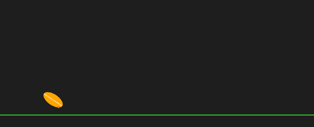

# 🏈 Football Physics Simulation

**외부 물리 라이브러리 없이 직접 구현한 2D 강체 물리 엔진으로, 미식축구공이 땅에 닿을 때의 불규칙한 바운스를 재현한 프로젝트**

경희대학교 SWCON211 게임프로그래밍 Project #3 *Develop Your Own Physics Engine*



*회색 점: 공 중심의 궤적, 빨간 점: 지면과 가장 가까운 접촉 후보점(지지점)*

## 왜 만들었나

미식축구의 **온사이드 킥**에서는 공이 땅에 닿을 때마다 어디로 튈지 예측하기 어렵습니다. 둥근 공과 달리 미식축구공은 길쭉한 타원형이라, 회전하며 기울어진 채로 땅에 닿으면 **끝부분이 먼저 닿는지 옆면이 먼저 닿는지**에 따라 완전히 다른 방향으로 튀기 때문입니다.
이 현상을 시각 효과가 아니라 강체 역학으로 재현하기 위해, 회전과 관성모멘트를 가진 강체 시뮬레이션을 처음부터 구현했습니다.

## 실행 방법

```bash
pip install -r requirements.txt
python main.py
```

| 조작 | 동작 |
|---|---|
| 마우스 왼쪽 드래그 | 당긴 방향의 반대로 발사 (슬링샷). 당긴 길이만큼 세게 |
| R | 공 위치와 상태 초기화 |

## 구현 내용

### 1. 강체 모델: 관성모멘트
공을 점이 아닌 위치·각도·속도·각속도를 가진 강체로 다룹니다. 2D에서는 타원판으로 근사해 관성모멘트를 계산합니다.

$$I = \frac{1}{4} m (a^2 + b^2)$$

($a$, $b$: 장축·단축 반지름) 공이 길쭉할수록 관성모멘트가 커져 회전이 잘 바뀌지 않습니다.

### 2. 수치 적분: Semi-Implicit Euler
속도를 먼저 갱신하고 그 속도로 위치를 갱신합니다. 일반 오일러 방법보다 에너지가 덜 발산해 게임 물리에 많이 쓰입니다.

$$v \leftarrow v + (F/m + g)\,\Delta t, \quad x \leftarrow x + v\,\Delta t, \qquad \omega \leftarrow \omega + (\tau / I)\,\Delta t, \quad \theta \leftarrow \theta + \omega\,\Delta t$$

공기 저항 등의 손실은 시간에 비례한 감쇠($v \leftarrow v\,e^{-k\Delta t}$)로 근사합니다.

### 3. 충돌 감지: 타원 지지점(Support Point)
회전하는 타원은 "중심 + 반지름"으로 바닥 충돌을 판정할 수 없습니다. 그래서 특정 방향으로 가장 많이 튀어나온 표면의 점(지지점)을 계산합니다.
1. 아래 방향 벡터를 공의 로컬 좌표계로 회전
2. 타원 방정식으로 그 방향의 최외곽 점 계산: $p = \dfrac{(a^2 d_x,\; b^2 d_y)}{\sqrt{a^2 d_x^2 + b^2 d_y^2}}$
3. 다시 월드 좌표로 변환

이 점이 바닥 아래로 내려가면 충돌입니다. 이를 통해 끝부분과 옆면 중 어디가 먼저 닿는지를 정확히 구분합니다.

### 4. 충돌 응답: 충격량과 마찰
1. 침투한 깊이만큼 위치 보정
2. 중심에서 접촉점까지의 벡터 $r$로 접촉점 속도 계산: $v_p = v + \omega \times r$
3. 법선 방향 충격량 (반발계수 $e$):

$$J_n = \frac{-(1+e)\,v_n}{\dfrac{1}{m} + \dfrac{(r \times n)^2}{I}}$$

4. 충격량을 선속도와 각속도에 모두 반영 → 끝부분으로 떨어지면 $r \times n$이 커져 강한 회전이 생김
5. 접선 방향은 쿨롱 마찰: 마찰 충격량을 $|J_t| \le \mu |J_n|$로 제한
6. 아주 느린 접촉은 반발계수를 0으로 처리해 바닥에서 떨리는 현상 방지

### 5. 안정화: 서브스테핑
빠른 물체가 한 프레임에 바닥을 통과하는 터널링을 줄이기 위해, 한 프레임(60 FPS)의 물리 계산을 8번으로 나눠 수행합니다.

## 구조

```
├── physics.py    # RigidBody2D (강체 속성, 적분), PhysicsEngine (중력, 지면 충돌, 서브스테핑)
├── football.py   # Football (타원 형상, 관성모멘트, 지지점, 그리기) - RigidBody2D 상속
└── main.py       # pygame 게임 루프: 입력(드래그 발사) → 물리 업데이트 → 렌더링
```

엔진·객체·애플리케이션 계층을 나눠, 다른 모양의 강체도 `RigidBody2D`를 상속해 추가할 수 있게 했습니다.

## 업데이트 (수업 제출 이후)

**감쇠가 프레임 속도에 따라 달라지던 문제 수정**

제출 버전은 물리 계산을 할 때마다 속도에 0.999, 각속도에 0.99를 곱했습니다. 이 계산은 서브스텝마다(1프레임에 8번) 일어나서, 1초 동안 곱해지는 횟수가 FPS에 따라 달라졌습니다. 공중에서 1초 뒤 남는 속도와 회전을 측정한 결과입니다.

| FPS | 수정 전 속도 | 수정 전 회전 | 수정 후 속도 | 수정 후 회전 |
|---|---|---|---|---|
| 30 | 78.7% | 8.96% | 61.9% | 0.81% |
| 60 | 61.9% | 0.80% | 61.9% | 0.81% |
| 144 | 31.6% | 0.00% | 61.9% | 0.81% |

같은 코드라도 144Hz 모니터에서는 공이 훨씬 빨리 느려졌습니다. 감쇠를 시간 기반($e^{-k\Delta t}$)으로 바꾸고, 60 FPS에서 기존과 같은 감쇠가 되도록 $k$를 맞췄습니다(60 FPS 궤적은 3초 뒤 위치 차이 2px). 함께 수정한 것:
- 프레임이 크게 밀렸을 때(창 이동 등) 한 번에 계산하는 시간을 최대 1/30초로 제한
- 화면 너비 하드코딩(1280)을 엔진 설정값으로 변경

측정하며 알게 된 점: 60 FPS에서 발사할 때 준 회전은 1초 안에 거의 사라집니다. 그래서 착지 후의 불규칙한 바운스는 발사 회전보다 **착지 순간 접촉점 위치가 만드는 충격 토크**에서 주로 나옵니다.

## 한계

- **2D 모델**: 실제 미식축구공의 3차원 회전(세차운동 등)은 표현하지 못합니다.
- **터널링**: 서브스테핑으로 줄였지만 극단적으로 빠른 속도에서는 완전히 막지 못합니다.
- **지면 충돌만 처리**: 벽이나 다른 물체와의 충돌은 없고, 화면 양 끝은 반대편으로 이어집니다.
- **감쇠 근사**: 회전 감쇠가 공기 저항 치고는 강한 편이라(1초에 99% 이상 감소), 실제 공보다 회전이 빨리 사라집니다.
